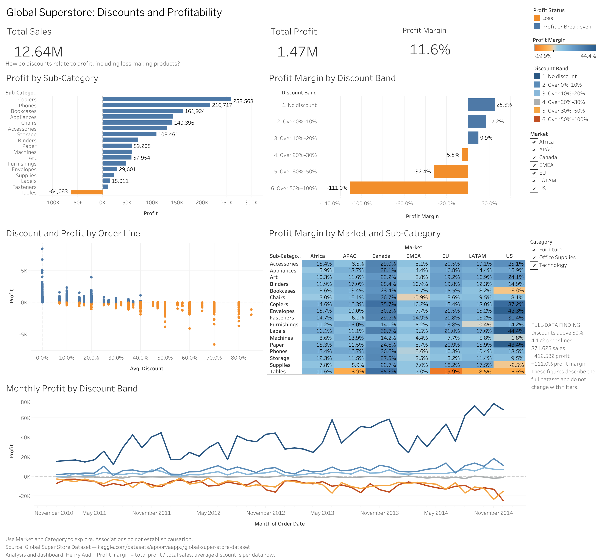
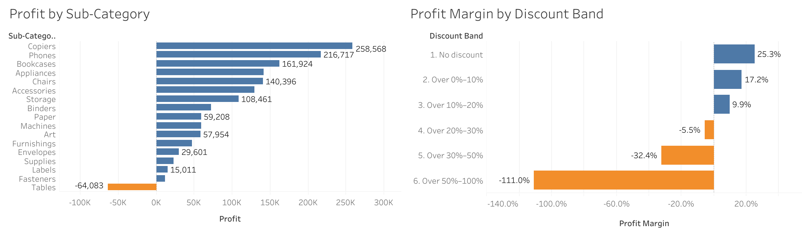
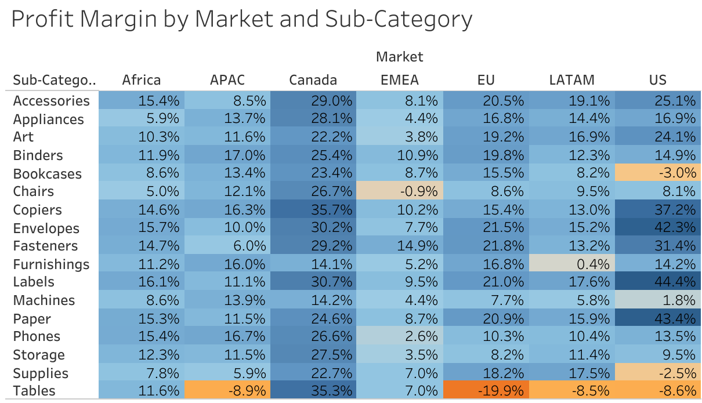
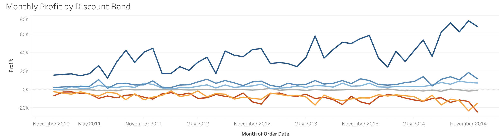

# Global Superstore Discounts and Profitability

**Tableau retail analysis by Henry Audi** — investigating how discounts relate to profit, including loss-making products.

This project examines 51,290 retail order lines from 2011–2014. It combines a Tableau dashboard with data-quality checks and reproducible aggregate calculations to identify discount bands and product-market combinations that warrant closer pricing review. It is an academic portfolio analysis, not a report of business improvements achieved.



## Business problem and objectives

Sales alone can hide losses. A retail manager needs to know whether discounting accompanies weaker profitability, where those losses occur, and whether they persist over time.

Questions explored:

- How does profit margin differ across six discount bands?
- Which product sub-categories generate losses, and how do results vary by market?
- Do losses in high-discount groups recur across months?
- What do individual order lines reveal that grouped totals can hide?

## Results at a glance

| Measure | Full dataset |
|---|---:|
| Order lines | 51,290 |
| Sales | 12,642,502 |
| Profit | 1,467,457 |
| Overall profit margin | 11.6% |
| Coverage | 17 sub-categories, 7 markets, 48 months |

Amounts are rounded to whole dataset monetary units. The source file does not explicitly identify a currency, so no currency symbol is assumed. All findings below refer to the full dataset unless stated otherwise.

## Key findings

### 1. Higher discount bands have lower margins

| Discount band | Order lines | Profit margin |
|---|---:|---:|
| No discount | 29,009 | 25.3% |
| Above 0% through 10% | 4,679 | 17.2% |
| Above 10% through 20% | 6,274 | 9.9% |
| Above 20% through 30% | 967 | -5.5% |
| Above 30% through 50% | 6,189 | -32.4% |
| Above 50% through 100% | 4,172 | -111.0% |

The highest band records 371,625 in sales and a 412,582 loss. A margin below -100% means recorded loss exceeds recorded sales. Product and market mix may differ across bands; the comparison does not isolate a causal effect of discounting.



### 2. Tables lose money overall, with important market differences

Tables are the only sub-category with negative total profit: a 64,083 loss on 757,042 in sales, or a -8.5% margin. Their average recorded discount is 29.1%.

EU Tables have a -19.9% margin and a 20,998 loss across 91 order lines, with a 36.8% average discount. Tables also lose money in APAC, LATAM, and the US. Canada's positive 35.3% Tables margin comes from only two rows and 849 in sales, so it is not a reliable benchmark.



### 3. High-discount losses persist over time

The bands above 30% through 50% and above 50% through 100% have negative total profit in every one of the 48 months. This is a repeated pattern rather than a single poor month. Monthly totals also reflect volume; sales, margin and counts provide context.



Line colors correspond to the discount-band legend in the full dashboard above.

## Recommendations

1. **Prioritize review of discounts above 30%.** Examine product cost, promotion objectives, order size and market mix. Test revised offers on comparable products and track profit margin alongside sales and quantity. This analysis does not establish an optimal cap or forecast savings.
2. **Investigate Tables by market, starting with EU.** Review loss-making order lines and compare similar products and order sizes. Avoid withdrawing the entire sub-category or generalizing from Canada's two-row result.

## Tools and skills

- **Tableau Public:** Excel connection, date typing, calculated fields, aggregation, sorting, tooltips, filters, bar charts, scatter plot, highlight table, monthly line chart and dashboard layout.
- **Excel source:** the original workbook supplied the data; preparation for the dashboard was performed in Tableau. This project does not claim Excel automation or SQL analysis.
- **Python / Pandas:** companion verification of counts, data quality, discount-band calculations, grouped results and reconciliation to the dashboard. The portable script adapts the existing project verification notebook for repository use; it is not a separate predictive model.
- **Communication:** three findings, two recommendations, metric definitions, source attribution and limitations.

## Data preparation and methodology

1. Connect to `Sheet1` in the assigned Excel workbook. Treat each unique Row ID as an order line; repeated Order IDs may contain multiple products.
2. Convert Order Date and Ship Date from day-month-year text to dates and check numeric field types.
3. Validate unique/present Row IDs, missing dates/measures/categories, duplicates excluding Row ID, shipping sequence, discounts between 0 and 1, positive sales and whole-number quantities, and nonnegative shipping costs.
4. Retain negative profit as valid loss evidence. Retain rows with missing postal codes: 41,296 rows (80.5%) lack Postal Code, but that field is not used. No rows were removed or imputed for these checks.
5. Define **profit margin = SUM(Profit) / SUM(Sales)**, not an average of row margins. Average discount is an unweighted row average. Profit Status uses the sign of profit at the displayed aggregation level.
6. Assign mutually exclusive discount bands: zero, (0, .1], (.1, .2], (.2, .3], (.3, .5], (.5, 1].
7. Compare products, markets and monthly outcomes; reconcile aggregate results to the saved dashboard.

The dashboard contains **five analytical views and three KPI sheets**, plus a separate Data Quality Check worksheet. Market and Category filters apply to the eight analytical/KPI sheets. Recorded tests covered EU alone, Furniture alone and their combination; EU + Furniture produced approximately 0.78 million sales, 0.07 million profit and an 8.8% margin. Both filters were restored before the dashboard export.

## Repository structure

```text
analysis/validate_analysis.py       Portable companion validation and aggregation
requirements.txt                   Python dependencies
images/                            Exported dashboard and chart details
results/                           Aggregate CSVs and validation summaries
tableau/global_superstore_profitability.twb  Workbook definition without embedded data
data/README.md                   Dataset acquisition instructions
```

Original files on the author's machine are preserved separately. The published workbook definition removes the embedded extract reference, local source path and view caches; worksheets, calculations and dashboard definitions are retained.

## Explore the dashboard

1. Inspect the full [dashboard image](images/dashboard.png) for a quick overview.
2. Obtain the credited source workbook as described in [data/README.md](data/README.md), and save it as `data/Global_Superstore2.xlsx`.
3. Open [the Tableau workbook definition](tableau/global_superstore_profitability.twb) in Tableau Public/Desktop. It was authored in Tableau 2026.2. If Tableau prompts for the source, select that local Excel file and `Sheet1`.
4. Open **Discounts and Profitability**. Select a Market or Category, hover for tooltips, then restore all selections to compare against the full dataset.

No Tableau Public URL is included because the exact published-view address was not recoverable from the available workbook metadata. No credentials or environment variables are needed.

## Run the companion analysis

Use Python 3.10+ in an isolated environment. From the repository root:

```bash
python -m venv .venv
# macOS/Linux
source .venv/bin/activate
# Windows PowerShell alternative: .venv\Scripts\Activate.ps1
python -m pip install -r requirements.txt
python analysis/validate_analysis.py --input data/Global_Superstore2.xlsx --output results
```

The script reads the Excel source, validates the project dataset, reconciles sales/profit and key findings, and writes aggregate-only outputs. It does not export names, customer identifiers or individual transactions. Existing `results/` files are replaced when the script is rerun. Input files remain unchanged.

## Verification and limitations

- Python validation was run against the actual project Excel source. Full-dataset totals and the 48-month high-discount loss pattern reconciled to the saved analysis.
- The Tableau XML was inspected: nine worksheets and one dashboard are present. The published `.twb` is structurally parseable, but reopening its sanitized connection in Tableau could not be verified in this publishing environment. It may require locating the Excel source on first open.
- Dashboard interactions were tested during project development; the static PNG is not interactive. Screenshots are exported evidence, not freshly rendered by the Python script.
- Historical academic retail data does not establish present-day company performance. Discounts are not randomly assigned; differences may reflect product, market and transaction mix.
- Scatter marks overlap. Small groups need caution, and a positive margin based on two rows should not drive policy.
- Potential improvements: compare like-for-like products, examine volume and promotion objectives, add minimum-sample warnings, and evaluate proposed changes with controlled tests. These are future work, not completed features.

## Data source and attribution

[Global Super Store Dataset](https://www.kaggle.com/datasets/apoorvaappz/global-super-store-dataset), uploaded by **apoorvaappz** on Kaggle; supplied workbook `Global_Superstore2.xlsx`. Review source terms before reuse. Raw data and extracts are intentionally excluded; no license over the underlying dataset is claimed.

**Author: Henry Audi** · [GitHub](https://github.com/dollarsaintt)
